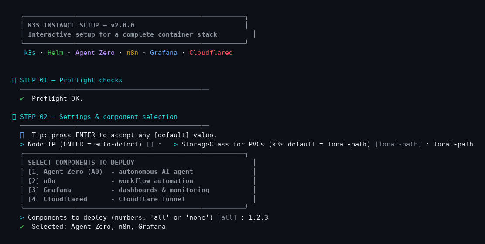
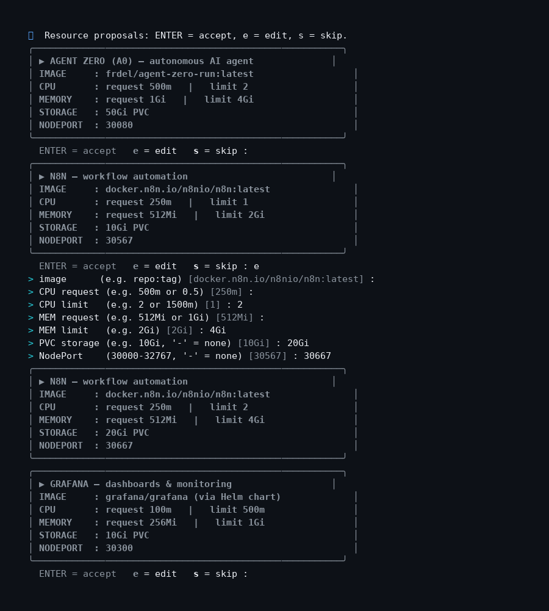
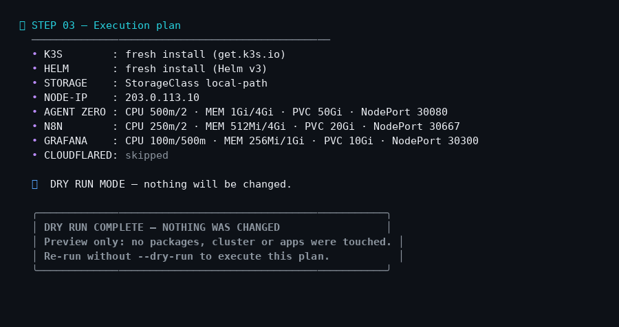

# k3s-instance-setup.sh

A colorful, interactive Bash script that prepares a fresh Debian/Ubuntu machine
as a complete **k3s** workstation: it installs **k3s** and **Helm 3**, then lets
you pick and size a stack of self-hosted apps:

| # | Component | Description |
|---|-----------|-------------|
| 1 | **Agent Zero (A0)** | Autonomous AI agent framework (`frdel/agent-zero-run`) |
| 2 | **n8n** | Workflow automation (`n8nio/n8n`) |
| 3 | **Grafana** | Dashboards & monitoring (official Helm chart) |
| 4 | **Cloudflared** | Cloudflare Tunnel connector (token-based) |

## Features

- **Choose your components** — an interactive menu lets you deploy any subset
  (`1,2,3`, `all`, `none` or the `COMPONENTS` env var).
- **Resource proposal cards** — every container gets a card with a proposal for
  CPU request/limit, memory request/limit, PVC storage and NodePort. You can
  **edit every value during the run** (`ENTER` = accept, `e` = edit, `s` = skip),
  with input validation for every field.
- **Reviewable plan** — before anything touches your system, the full execution
  plan is printed and you confirm it.
- **Idempotent** — re-running updates existing resources (`kubectl apply`,
  `helm upgrade --install`); k3s/Helm installs are skipped when already present.
- **Secrets stay in Kubernetes** — passwords and keys are created via
  `kubectl create secret`, never written into plain YAML manifests.
- **Dry-run mode** — walk through the entire interactive flow and see the final
  plan without changing anything.
- **Summary report** — credentials, URLs and chosen resources are saved to
  `/root/instance-setup-summary.txt` (mode 600) at the end of a real run.

## Screenshots

Component selection menu:



Resource proposal cards (this run edits the n8n card: CPU 2, memory 4Gi,
storage 20Gi, NodePort 30667):



Execution plan + dry-run confirmation:



## Quick start

```bash
git clone https://github.com/jphermans/k3s-instance-setup.git
cd k3s-instance-setup
chmod +x k3s-instance-setup.sh

# Preview the interactive flow (changes nothing):
sudo ./k3s-instance-setup.sh --dry-run

# Real installation:
sudo ./k3s-instance-setup.sh
```

### Options

| Flag | Effect |
|------|--------|
| *(none)* | Interactive mode (recommended) |
| `-d`, `--dry-run` | Show the full interactive flow and plan, then exit — no changes |
| `-y`, `--yes` | Accept all defaults (non-interactive) |
| `-h`, `--help` | Show help |

### Environment variables (useful with `-y`)

| Variable | Purpose |
|----------|---------|
| `COMPONENTS` | Comma-separated component list: `a0,n8n,grafana,cloudflared` or `all` |
| `CLOUDFLARED_TOKEN` | Cloudflare Tunnel token (Cloudflared is skipped when unset) |
| `A0_PASSWORD` | Agent Zero login password |
| `GRAFANA_PASSWORD` | Grafana login password |
| `N8N_ENCRYPTION_KEY` | n8n encryption key |

## Default resource proposals

| Component | CPU req/lim | Mem req/lim | PVC | NodePort |
|-----------|-------------|-------------|-----|----------|
| Agent Zero | 500m / 2 | 1Gi / 4Gi | 50Gi | 30080 |
| n8n | 250m / 1 | 512Mi / 2Gi | 10Gi | 30567 |
| Grafana | 100m / 500m | 256Mi / 1Gi | 10Gi | 30300 |
| Cloudflared | 50m / 250m | 64Mi / 256Mi | — | — |

All values can be changed interactively while the script runs.

## What gets deployed

- **Namespaces**: `agent-zero`, `n8n`, `monitoring`, `cloudflared`
- **Agent Zero / n8n**: Deployment + PVC + NodePort Service via generated manifests
- **Grafana**: official `grafana/grafana` Helm chart, configured with an existing
  admin secret, persistence and NodePort
- **Cloudflared**: 2 replicas with liveness probe (`/ready` on port 2000),
  tunnel token injected from a Kubernetes secret

## Requirements

- A fresh **Debian/Ubuntu** machine (apt-based), root access
- Internet access to `get.k3s.io`, Helm mirrors and container registries
- ~4 GB RAM minimum for a full stack (more is recommended for Agent Zero)

## Safety notes

- The script is **idempotent** and skips components you deselect, but a real run
  installs system-wide packages and cluster workloads — review the plan before
  confirming.
- Test it first with `--dry-run`, or on a disposable VM.
- This script was validated with `bash -n` syntax checks and full `--dry-run`
  runs; it has **not** been battle-tested on every distro version. Review the
  manifests before production use.

## License

[MIT](LICENSE)
